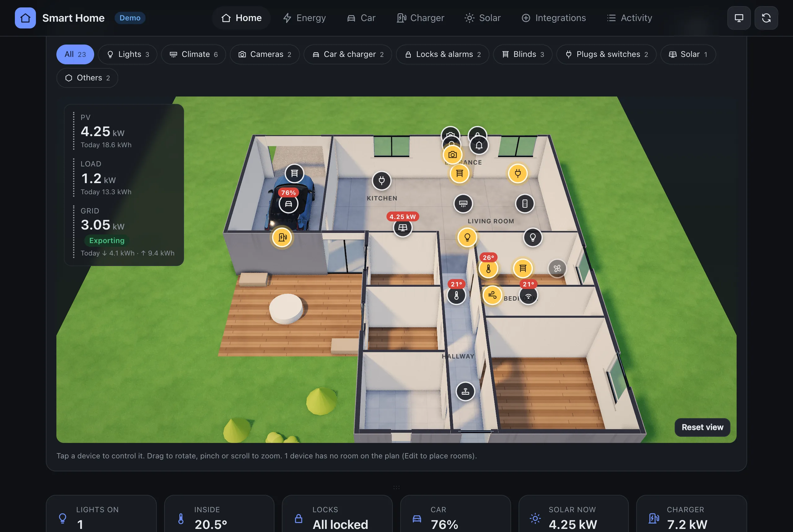
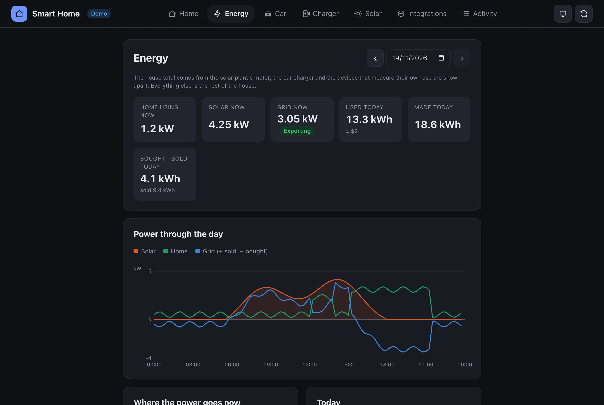
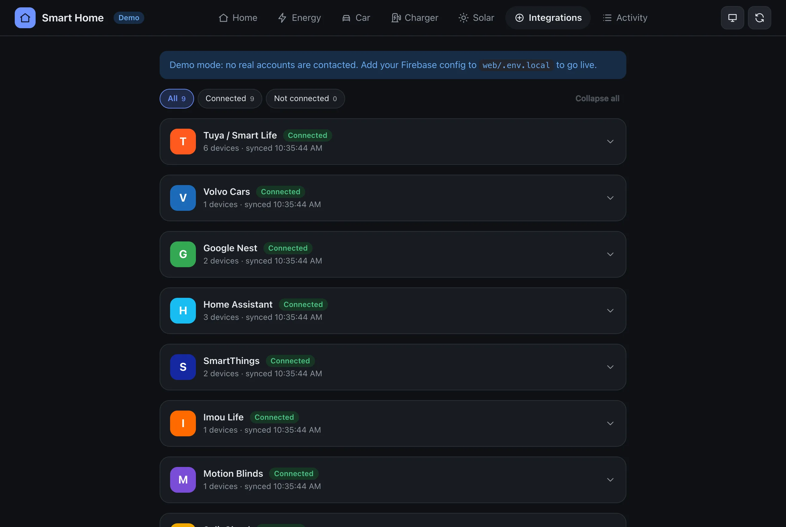
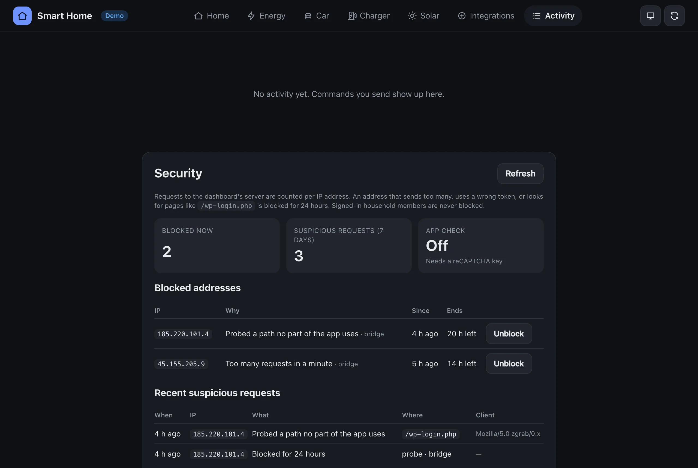
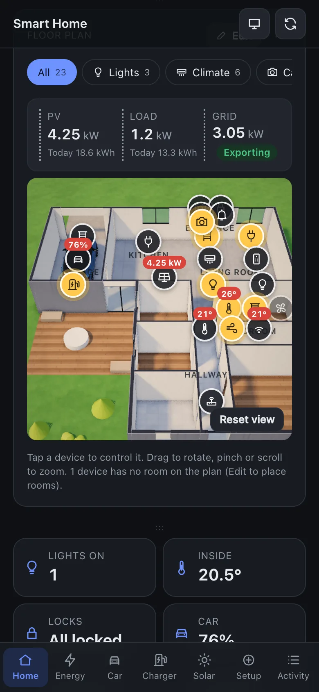
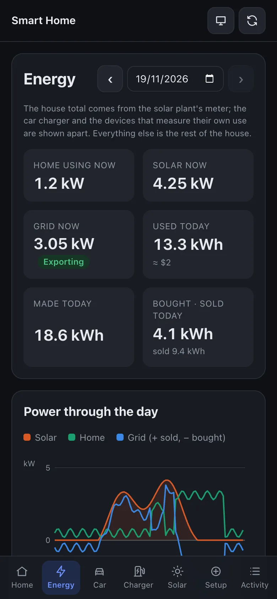
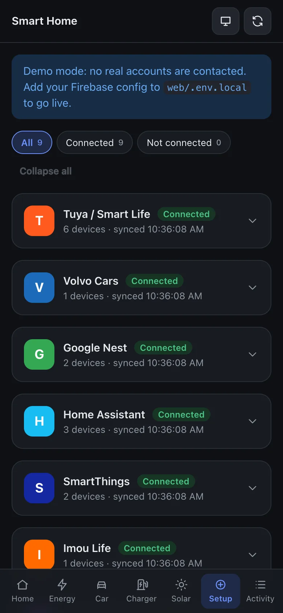
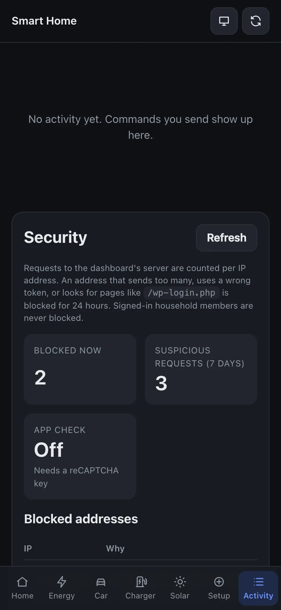

# Smart Home Dashboard

One dashboard for Tuya / Smart Life devices, your Volvo, Tesla, BYD, Volkswagen or Hyundai, Google Nest, and anything else via Home Assistant.
React + Vite frontend, Firebase Auth + Firestore + Cloud Functions backend.

```
web/            React app (Home, Energy, Car, Charger, Solar, Integrations, Activity tabs)
functions/      Cloud Functions: provider integrations, sync, commands, OAuth, per-IP guard
bridge/         Runs at home for LAN-only devices (Motion Blinds)
home.example/   Sample household configuration (copy to home/, which git ignores)
firestore.rules
```

## Screenshots

Demo mode with the sample home (`npm --prefix web run demo:sample`).

| Home | Energy |
| --- | --- |
|  |  |
| **Integrations** | **Activity** |
|  |  |

| Home | Energy | Setup | Activity |
| --- | --- | --- | --- |
|  |  |  |  |

To retake them, run the sample demo and then `node web/scripts/screenshots.mjs` (uses your installed Google Chrome).

## How it works

```
Browser ──callable──▶ Cloud Functions ──▶ Tuya / Volvo / Tesla / BYD / Volkswagen / Hyundai / Google SDM / Home Assistant APIs
   ▲                       │
   └──── live snapshot ─── Firestore (devices, integrationStatus, events)
```

- **Credentials never reach the browser.** API keys and OAuth tokens live in `integrations/*`, which
  Firestore rules make server-only. You enter them once on the Integrations tab.
- Devices from every provider are normalized into `devices/{provider_id}` with a common `state` and
  `capabilities` list, so the UI doesn't care where a device came from.
- Commands (`sendCommand`) go through Functions, update the device doc and append to `events`.
- `scheduledSync` refreshes all providers every 15 minutes; the ↻ button syncs on demand.
- Access is an email allowlist in `config/access`. The first person to sign in claims the dashboard;
  add other household members to the `emails` array in the Firestore console.

## Try it without any accounts

```bash
npm run setup
npm run demo
```
Open http://localhost:5173. Demo mode uses sample devices in memory.

## Set up for real

1. **Firebase project** (Blaze plan is required for Cloud Functions and outbound API calls).
   - Create a project, add a Web app, enable **Authentication → Google** and **Firestore**.
   - Copy `.firebaserc.example` to `.firebaserc` and put your project ID in it.
   - Copy `web/.env.example` to `web/.env.local` and fill in the web app config.
   - Copy `functions/.env.example` to `functions/.env` and set `HOME_TZ` to your time zone.
2. **Your home:** `cp -R home.example home`, then edit it (see [Your home](#your-home)).
3. **Deploy:** `firebase deploy` (builds the web app, deploys hosting, rules and functions).
4. Open the hosted URL, sign in with Google, and **Claim dashboard**.
5. On **Integrations**, set up each provider:

| Provider | What you need | Notes |
| --- | --- | --- |
| Tuya / Smart Life | Cloud project at iot.tuya.com with your app account linked; Access ID + Secret | Pick the endpoint for your data center. Syncs immediately on save. |
| Volvo | App at developer.volvocars.com: client ID, secret, VCC API key | Register the redirect URI shown in the card, then **Connect**. |
| Tesla | App at developer.tesla.com (Fleet API): client ID + secret | Host your public key, register as a partner in each region, add the redirect URI shown in the card, then **Connect**. Read-only; sleeping cars are not woken. |
| Hyundai | Pleos Vehicle Data API client ID + secret, and your VIN | Europe only (EU Data Act); needs Pleos approval. Syncs on save. |
| Volkswagen | Gateway URL + API key | Unofficial / best-effort: VW has no public owner API, so status comes from a gateway you run or subscribe to. |
| BYD | Gateway URL + API key | Unofficial / best-effort: BYD has no public owner API, so status comes from a gateway you run or subscribe to. |
| Google Nest | Google Cloud OAuth client + Device Access project (US$5 one-time) | Only Nest thermostats/cameras/doorbells are available via Google's cloud API. |
| Home Assistant | Public URL + long-lived token | The bridge for everything else (Zigbee, Z-Wave, Matter, Hue, Shelly…). |
| Motion Blinds | Motion key (from the app) + the home bridge in `bridge/` | The gateway API is LAN-only, so `bridge/motion-bridge.mjs` runs at home and relays state and commands. See `bridge/README.md`. |

The OAuth redirect URI is `https://us-central1-<project-id>.cloudfunctions.net/oauthCallback`.

### Local development against emulators

```bash
npm run emulators            # auth, firestore, functions (needs Java)
# in web/.env.local: VITE_USE_EMULATORS=true
npm run dev
```

## Your home

Everything about your own household lives in `home/`, which git ignores, so your house plan and
photos never reach the repository. Without it the app uses the sample in `home.example/`.

| File | What it holds |
| --- | --- |
| `home/site.json` | The app's name and the contact email shown on the terms page. |
| `home/house.ts` | The one-floor plan behind the 3D view on the Home tab: rooms (with the room names that map to them), walls, doors, windows, furniture and the plot. Export `null` to hide the plan. |
| `home/home.config.ts` | Car profiles with photos, and the page background photos. |

To trace your house, open a floor plan image, read the corners in pixels and set `scale` to
metres per pixel. `npm --prefix web run export:glb -- ../home/house.glb` saves the result as a
glTF model you can open in Blender or any 3D viewer.

Keep `home/` backed up somewhere private (a private repository or a synced folder).

## Adding another integration

Create `functions/src/providers/<name>.js` exporting `{ id, requiredConfig, configFields, listDevices(cfg, ctx), command(cfg, device, action, value, ctx) }`
(plus `oauth` if it uses OAuth), register it in `providers/index.js`, and add its form to `web/src/providers.ts`.
`listDevices` returns normalized devices: `{ providerId, name, type, online, state, capabilities, meta }`.

## Security notes

- Unlocking the car or a door asks for confirmation in the UI; every command is logged in **Activity** with who sent it.
- Credentials are stored in Firestore (server-only by rules, encrypted at rest). For stricter setups, move them to
  Secret Manager (`defineSecret`) — each provider reads them from one `loadConfig()` call in `functions/src/lib/service.js`.
